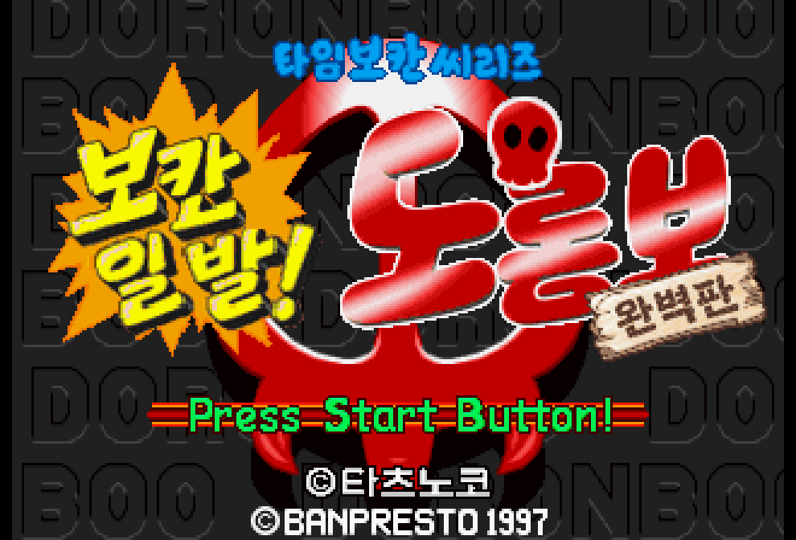
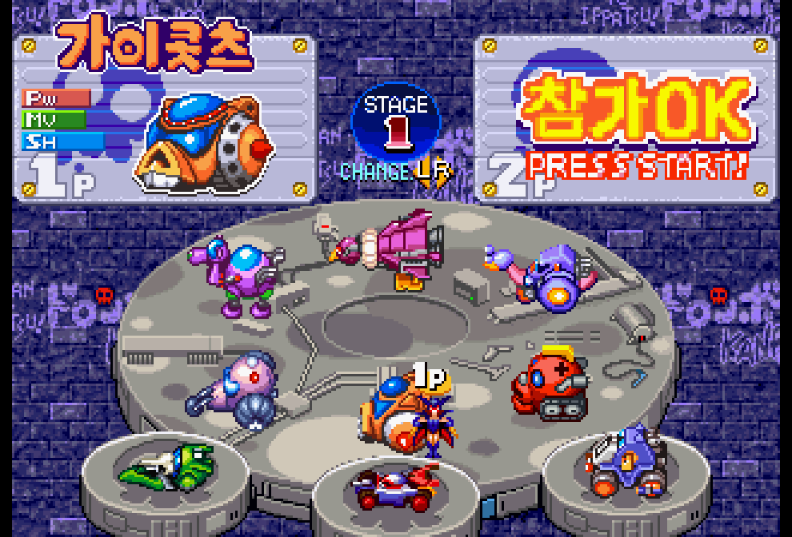
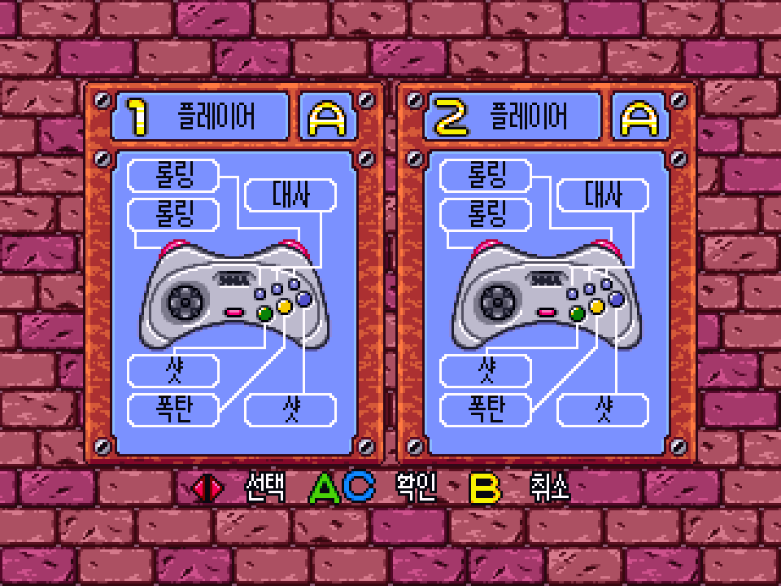
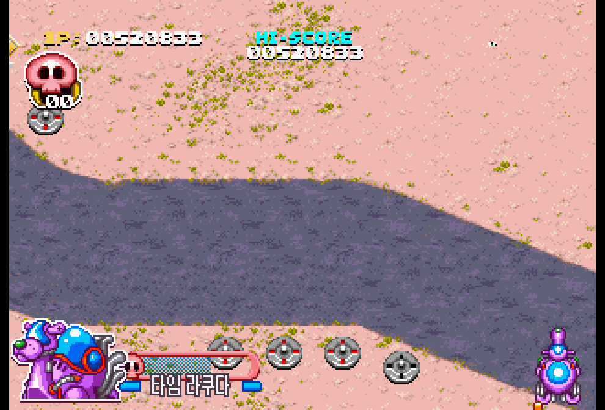
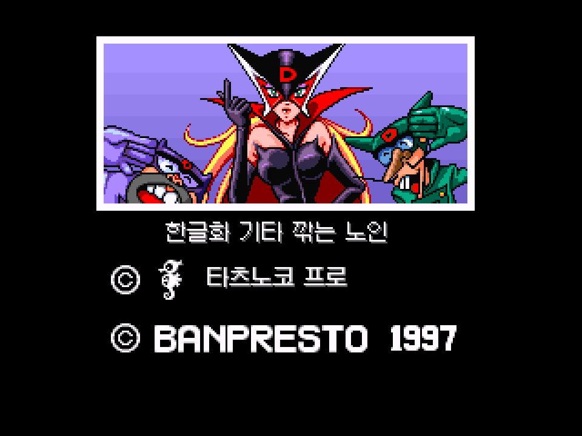

# 타임 보칸 시리즈 — 보칸 일발! 도론보 완벽판

**세가 새턴 · 비공식 한글화 V1.0 정식 버전**  
**한글화: 기타 깎는 노인**

1997년 일본판 *Time Bokan Series - Bokan to Ippatsu! Doronbow Kanpekiban*의 비공식 한국어 패치입니다. 원작의 도트 그림과 분위기를 살리는 방향으로 메뉴, 게임 내 문구, 영상 자막과 엔딩을 작업했습니다.

**특별한 오류가 발견되지 않는 한 추가 업데이트는 예정되어 있지 않습니다.**

## 다운로드

[**V1.0 정식 배포 다운로드**](https://github.com/OldManCraveGuitars-bit/SS-Time-Bokan-Series-Bokan-to-Ippatsu-Doronboo-Kanpekiban-Kr/releases/tag/v1.0)

| 파일 | 내용 |
|---|---|
| `Bokan-KR-V1.0.zip` | EXE 패처, BPS 패치, 클리어 세이브, 적용 설명서 및 라이선스를 포함한 전체 패키지 |
| `Bokan-KR-Patcher-V1.0.exe` | Windows 64비트용 단독 실행 패처. Python 설치 없이 실행 가능 |
| `Bokan-KR-V1.0.bps` | 원본 Track 01에 적용하는 표준 BPS 패치 |
| `Bokan-KR-V1.0-Clear-Save.zip` | 매우 어려움 클리어 플래그가 적용된 세이브와 적용 설명서 |
| `Bokan-KR.srm` | 바로 복사해서 사용할 수 있는 같은 클리어 세이브 |
| `SHA256SUMS.txt` | 배포 파일의 SHA-256 목록 |

원본 게임 ROM과 BIOS, 음악 트랙은 포함하지 않습니다. 원본 일본판 BIN/CUE를 별도로 준비하세요.

## 적용 방법

1. **일본판 40트랙 분할 BIN/CUE**를 준비합니다. Track 01은 아래 해시와 같아야 하며, 음악 트랙 39개도 함께 있어야 합니다.
2. `Bokan-KR-V1.0.zip`을 풀고 **`Bokan-KR-Patcher-V1.0.exe`**를 실행합니다.
3. 원본 `.cue`를 선택하고, 출력 위치에 **아직 존재하지 않는 새 폴더**를 지정합니다.
4. **한글판 만들기**를 누릅니다. 패처는 모든 원본 트랙을 검증하고 한글판 데이터 트랙과 음악 트랙을 새 폴더로 복사합니다. 원본 파일은 바꾸지 않습니다.
5. 완료되면 생성된 **`Bokan-KR.cue`**를 실행합니다. BIN만 실행하면 음악 트랙을 읽지 못할 수 있습니다.

새 출력 폴더에는 약 **463 MiB**가 필요합니다. CUE는 상대 경로를 사용하므로 **CUE와 BIN 40개를 담은 출력 폴더 전체**를 함께 이동하면 됩니다. CHD, 단일 BIN, 음악이 누락되거나 손상된 원본은 이 EXE 패처에서 지원하지 않습니다.

### 에뮬레이터 호환성

**RetroArch의 Beetle Saturn 코어로 플레이하는 것을 권장합니다.**

**Yabause v0.9.15에서는 1스테이지 보스 등장 구간에서 BGM이 멈추고 게임이 진행되지 않는 문제가 확인되었습니다.** 패치를 적용하지 않은 **일본판 원본에서도 같은 증상이 발생하는 에뮬레이터 호환성 문제**입니다. Beetle Saturn v1.32.1에서는 해당 구간 통과와 최종 보스 등장·전투, BGM 재생을 확인했습니다.

실행에 필요한 새턴 BIOS와 에뮬레이터 설정은 별도로 준비하세요. **Beetle Saturn에서 `Bokan-KR.cue`를 새로 실행하고, Yabause에서 저장한 스테이트는 불러오지 마세요.** 이전 한글 패치 버전의 스테이트에도 옛 이미지 데이터가 남을 수 있으므로 새로 실행하는 것을 권장합니다.

## 게임이 너무 어려우면: 클리어 세이브

동봉된 **`Bokan-KR.srm`**은 **매우 어려움 클리어 플래그를 적용한 새턴 백업 RAM**입니다. Beetle Saturn에서 스테이지 선택 표시와 L/R 변경을 확인했습니다.

1. RetroArch를 **완전히 종료**합니다.
2. 기존 `Bokan-KR.srm`을 다른 폴더나 이름으로 **백업**합니다. 제공 세이브를 적용하면 기존 진행 기록과 옵션을 대체합니다.
3. 동봉 세이브를 RetroArch의 저장 파일 폴더로 복사합니다. 코어별 저장을 사용하면 보통 `saves/Beetle Saturn/Bokan-KR.srm`입니다. 실제 경로는 **설정 → 디렉터리 → 저장 파일**에서 확인하세요.
4. 게임 CUE와 세이브의 이름을 맞춥니다. `Bokan-KR.cue`에는 `Bokan-KR.srm`을 사용합니다. 게임 이름을 바꾸었다면 세이브도 같은 이름으로 바꿉니다.
5. 옛 스테이트를 불러오지 말고 게임을 새로 실행합니다.
6. **옵션에서 크레딧 수를 조정**하고, **메카 선택 화면 중앙의 STAGE 항목에서 L/R로 시작 스테이지를 선택**합니다.

이 파일은 스테이트(`.state`)가 아닌 일반 세이브(`.srm`)입니다. 다른 에뮬레이터에서는 저장 형식과 파일 이름이 다를 수 있습니다. 자세한 안내는 [클리어 세이브 설명서](clear-save/README.txt)에 있습니다.



## 한글화 내용

- 타이틀, 메뉴와 옵션, 조작 안내, 메카 이름과 게임 중 문구
- 원본 영상과 일본어 음성을 유지한 한국어 자막
- 엔딩 크레딧과 마지막 카드의 **한글화 기타 깎는 노인** 표기
- 원작의 팔레트, 입체감과 글자 각도를 고려한 도트 이미지

일부 효과 그림은 원작의 표현을 유지했습니다. 작은 배경 간판과 장식 글씨 일부는 일본어 원본으로 남아 있습니다.

### 조작 안내



### 영상 자막


### 게임 화면



### 엔딩



## 해시값

아래 값은 모두 **SHA-256**입니다. 원본 Track 01의 크기는 **132,401,136바이트**입니다. 음악 트랙 39개를 포함한 원본 전체의 파일 크기와 해시 목록은 [patch/manifest.json](patch/manifest.json)에 있습니다.

| 대상 | SHA-256 |
|---|---|
| 원본 일본판 Track 01 BIN | `7c4dd865994bb9d70d83b038c61ce0d582e3ac4aa7914a98b6ec5f874a96636c` |
| 한글판 `Bokan-KR-Track01.bin` | `1ddc6d1ad98af2875bad8434dfd4356ac3fb16feed6fc717dccf92003c1fc5f4` |

| 파일 | SHA-256 |
|---|---|
| `Bokan-KR-V1.0.zip` | `0b65b76fc5373f942a86bc4ea469792840c4f048be82abc651866d563eadee6f` |
| `Bokan-KR-Patcher-V1.0.exe` | `7fe330942f2eb0d1d97bcd22f8617e1a0c05f2c7c2b563bfb9199632501b3161` |
| `Bokan-KR-V1.0.bps` | `3552d1fd670bb4fba872f83c0d0e4fe1ccc807291e82d127b7552e5a656dea59` |
| `Bokan-KR-V1.0-Clear-Save.zip` | `6916c477fa4cff06eeebb6301f3c8b87540ec8abc41a47fd1d6b73b332a9c96c` |
| `Bokan-KR.srm` | `70975683d130655aede0334c0d0edc4fb867a11c949c12617627cf37451d6175` |

[SHA256SUMS.txt](SHA256SUMS.txt)를 내려받아 배포 파일을 확인할 수 있습니다. Windows PowerShell에서는 다음처럼 확인합니다.

```powershell
Get-FileHash -Algorithm SHA256 .\Bokan-KR-V1.0.zip
```

## 확인 범위와 참고

Windows EXE 패처로 생성한 데이터 트랙의 최종 해시와 음악 트랙 39개의 원본 일치를 확인했습니다. 표준 BPS 도구인 Flips v198로 적용한 결과도 같은 해시였습니다. 화면 표시와 클리어 세이브의 스테이지 선택을 에뮬레이터에서 확인했으며, 전 구간 무결점 플레이나 실기 구동을 보증하는 표기는 아닙니다.

패처 소스와 빌드 방법은 [patcher/README.md](patcher/README.md)에 있습니다. 폰트 및 실행 환경의 라이선스는 [licenses](licenses)에 포함했습니다. 게임의 권리는 원 권리자에게 있습니다.
